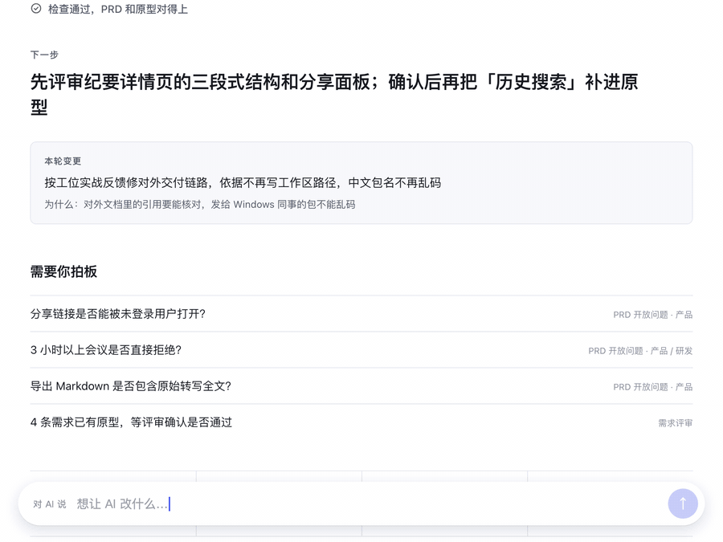
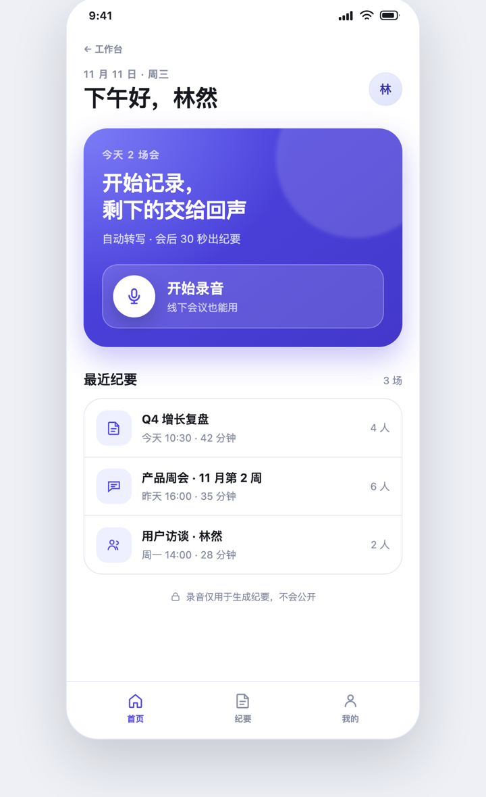

# 产品设计工位 · AI Product Studio

[中文](README.md) · **English**

> The Chinese README ([README.md](README.md)) is the source of truth. This English version may lag behind it.

**My wife is a product manager. She doesn't write code, doesn't use git, and doesn't touch the terminal, so this studio was built around her.**

She only talks to the AI. The AI keeps the PRD and the clickable prototype in sync, and the dashboard puts the things she needs to decide in front of her.

- No git, no command line, no skill names to remember, and no need to know where files live.
- The dashboard (`工作台.html`) isn't where the work happens — comments and conversation are the entry point. It keeps the record: what changed this round, who signed off, what's still waiting on you.
- Consistency doesn't depend on the AI "remembering"; `npm run check` enforces it every time. There are no runtime dependencies, and no `npm install`.

**[▶ Live demo](https://chee-0806.github.io/ai-product-studio/)** (a read-only dashboard of the sample product "Echo Minutes") · [Start with one command](#start-a-new-project)



## Why this exists

My wife is a product manager. She doesn't write code, doesn't use git, and doesn't touch the command line. Rather than make her learn a toolchain, it's better to let the tool pretend it isn't there.

She talks like "The home page is too crowded, keep only Start Recording and the latest three," not "change this component for me." So this studio makes only one promise: she asks for things the way she normally talks, and the AI does the rest: updates the PRD, updates the prototype, runs the checks, refreshes the dashboard, and opens it for her to look at.

The cost is that I have to make the machinery solid. Every requirement has a fixed ID, and the matching element in the prototype must carry it. A requirement marked "prototype done" must really have a page, and one marked "cut" must not still have one. The PRD version and the dashboard version must match. Only a machine can check these; you can't count on the AI to "remember".



Repository: https://github.com/Chee-0806/ai-product-studio

## Five terms to keep straight

| Term | What it means |
| --- | --- |
| **Template project** | This repository. It only generates studios and doesn't hold any specific product. |
| **Launcher skill** | `product-studio`, installed at user level. It creates a studio from an empty folder, upgrades a studio, and diagnoses the environment. It ships with its own template and doesn't need the network. |
| **Studio** | A per-product workspace where the AI edits the PRD and the prototype. |
| **Dashboard** | `工作台.html` at the studio root. An auto-generated snapshot and ledger: what changed this round, who signed off, what's still waiting on you, requirement progress, and the prototype. It can lag behind the workspace; the generation time is printed at the top. |
| **Delivery package** | A zip for engineers, containing only the PRD and the prototype. |

## First time: say one sentence to the AI

There's nothing to install, no folder to open, and no command to type. Open the AI assistant you normally use (Claude Code / Cursor / Codex), start a new conversation, and send this as-is:

> Build me a product studio from https://github.com/Chee-0806/ai-product-studio. The product is called "Baby Feeding".
> Install whatever you need yourself; if you can't install something, stop and tell me where you're stuck. Don't make me run commands.

It installs what it needs, builds the studio, runs the checks, and then opens the dashboard for you.

If it says this computer is missing a runtime and it can't install it, that's a permissions or network problem, not something you did wrong. Just pass its message to whoever sets up your computer.

A maintainer who wants to skip the download each time can install the launcher skill by hand once (`npm run launcher:install`); after that, creating a studio no longer needs the network. Product managers don't need to do this step.

The AI refreshes and opens the dashboard after every change; you can also double-click `工作台.html` in the studio folder yourself. The top of the page shows the result of the latest check. If it turns red, the content may not be up to date: ask the AI to fix it and refresh.

> Enterprise projects have an optional set of adaptations: three prototype forms (mobile / desktop / responsive), an SPA manifest, an allowlist for external resources, and a "basis" field on requirements. Not every project needs them; use them as needed. See [`docs/enterprise.md`](docs/enterprise.md).

## She only needs to do three things

1. **Look at the dashboard**: the AI opens it for you after it makes changes. It shows the current phase, the next step, what changed last round, and what needs your decision.
2. **Tell the AI your ideas directly**: no need to write a document first. It asks the key questions, then updates the PRD and the prototype.
3. **Click through the prototype**: tell the AI what you're unhappy with; after it makes the changes it refreshes the dashboard and opens it again.

No git, no command line, and no need to know where files are. Checks, version records, refreshing, and opening the dashboard are all done by the AI.

## Common workflow: say one sentence, and the AI follows the process itself

**You don't need to remember skill names.** Describe the situation in plain words; the AI picks the method and follows the steps in order, using the routing in `AGENTS.md`.

A requirement usually moves from idea to deliverable like this:

1. **Say the idea**: a vague direction, interview notes, or customer feedback are all fine. You don't need to tidy anything up first; the AI asks the key questions.
2. **Write it up as a PRD**: what to build and what counts as done. Every requirement has acceptance criteria, and you get a PRD you can review.
3. **Build the prototype**: you get clickable pages, the main flow works end to end, and it can also be viewed on a phone.
4. **Review together**: it checks that the PRD and the prototype match, and tells you what must be changed, what is suggested, and what is still waiting for your decision.
5. **Export and deliver**: you get the delivery package for engineers, a Word document for review, and a PPT for reporting upward.

If you already have requirements or pages to change, there's no need to start over: just say what's wrong. The AI updates the PRD and the prototype together, then goes back to review.

> By default only 4 core skills are installed: building pages, review, change sync, and deliverables. For steps 1, 2, and 5 above, if the optional pack `pm-methods` is installed, a fuller methodology is used (diverging on ideas, writing the PRD to a framework, writing reports by audience). Without it you can still do all of this; the AI uses general methods to do the same things.

### The four most common

**1. From idea to clickable prototype**

> I have an idea: a feeding-log tool for new moms. Don't write a plan yet, ask me a few key questions first.

With `pm-methods` installed, the AI first helps you diverge on the idea, then writes the PRD, builds the prototype, and reviews. Without it, the core flow does the work directly.

What you get: the requirements in the PRD, a clickable prototype, and a refreshed dashboard.

**2. Change an existing feature**

> The home page is too crowded. Keep only Start Recording and the latest three.

With `pm-methods` installed, the AI first finds which requirements are affected, tidies up the PRD if needed, then changes the prototype and reviews. Without it, it changes the requirements and the prototype together.

What you get: the PRD and the prototype updated together, the version bumped by 1, and a refreshed dashboard.

**3. Review / wrap-up**

> Review it: see where the PRD and the prototype disagree, and what's still undecided.

The AI runs: `review`. It runs the machine checks first, then gives you "must fix / suggested / can't verify".

**4. Deliverables**

> Export a review Word doc / make review material for the client / make a reporting PPT / send it to engineering.

The AI runs: `deliver`. The package for engineers can be assembled mechanically; the Word doc, PPT, cover page, approval block, and revision history are produced by the agent for the audience, not by hard-coded scripts.

### How to say it in other situations

| You say (examples) | The AI runs | You get |
| --- | --- | --- |
| I have an idea / help me diverge / is this direction viable | `product-brainstorming` | Directions, assumptions, risks |
| Here are my interview/survey/support records, help me summarize them | `synthesize-research` | Themes, evidence, opportunities |
| Write the requirements up as a PRD / add a requirement / add acceptance criteria | `write-spec` | REQ blocks and acceptance criteria |
| What goes in phase one / what to cut / set priorities | `roadmap-update` | Must / should / could / won't |
| Build a new page / add an empty state | `prototype` | Clickable pages |
| Review it / check consistency | `review` | Must fix / suggested / unverified |
| Change an existing page / change copy / change a requirement | `change` | Both sides synced + version bump |
| Export the delivery package / review Word / reporting PPT | `deliver` | Deliverables organized by audience, with self-check results |
| Write a weekly report / report upward / release announcement | `stakeholder-update` | A draft tailored to the audience |
| Look at competitors / make a competitor comparison | `competitive-brief` | A competitor brief |
| Look at metrics / review this week's data | `metrics-review` | A metrics review and actions |
| Plan the next iteration | `sprint-planning` | An iteration plan (optional) |

You don't need to memorize this table. Just say clearly what the situation is and what you want to get, and the AI will choose. If it chooses wrong, say "that's not what I wanted, switch to another one."

The rows that carry Anthropic method names require `pm-methods` to be installed first. Without it, the AI uses the core flow and general methods; the output just isn't as framework-shaped.

## The first message to give the AI

Open the folder in an AI that can read and write local files, such as **Claude Code / Cursor / Codex**, then paste:

```text
You are my product partner. First read AGENTS.md, STATE.md and product/PRD.md, and tell me in one sentence where we are and what's next.
Then make changes as I ask. When you're done, run npm run sync and npm run check yourself, refresh the dashboard, and tell me: which requirements changed, which pages changed, and what's still undecided.
Don't ask me to run commands, and don't make me touch git.
```

After that, just describe requirements normally, for example:

- "I want to build a tool for new moms to log baby feeding. Don't write a plan yet; ask me 10 key questions first."
- "The home page is too crowded. Keep only Start Recording and the latest three."
- "This flow is missing an empty state. Please add one."
- "Check whether the PRD and the prototype are consistent, and refresh the dashboard."

## What the dashboard looks like

`工作台.html` is generated by a script. It isn't an entry point — comments and conversation are — it keeps a record: what changed this round, who signed off, what's still waiting on you.

- **Identity line**: which PRD version, whether checks passed, when it was generated, how many requirements and pages. One line tells you whether this snapshot is safe to review.
- **Next step**: the current phase and the next concrete thing to do (from `STATE.md`).
- **This round's changes**: not the AI's own account — every change listed as rewrite, structure, or commitment. Requirement edits, priority changes, acceptance edits, and decision-record changes are commitments, and stay red until you confirm them.
- **Waiting on you**: unconfirmed changes, decisions you owe (PRD open questions, handoff blockers, requirements waiting for review), long-standing questions, and the promise ledger — what was promised for the next round, which requirements were signed off and by whom, and what was explicitly decided against.
- **Requirement progress**, **prototype pages**: demoted to reference, collapsible.
- **How to use**, **To send to engineering**: folded at the bottom.

Thumbnails are rendered with the page styles inlined, so you can **just double-click the HTML**; no local server is needed. Pages with external resources, oversized SPAs, or map pages automatically degrade to placeholder cards. When that happens, ask the AI to run `npm run previews` once: it uses the local browser to screenshot each screen into a preview image, and the dashboard no longer shows placeholder cards.

## How to send it to engineers

Day to day, the whole folder is the **workspace**; don't zip it up and send it as is. It also contains `STATE.md`, scripts, the internal dashboard, and research notes.

Tell the AI one thing: **"Export the delivery package."** It runs the `deliver` skill, checks consistency first, and then assembles the package directly (there is no `npm run export` script):

```text
dist/
  回声纪要-v0.2.0/
    index.html              delivery home page (open this first)
    PRD.html                the PRD, readable as-is
    PRD.md                  the original Markdown
    README.md               delivery notes
    prototype/
      index.html            prototype index
      screens/*.html        clickable pages (multi-page)
      assets/*.css          shared styles
  回声纪要-v0.2.0.zip       this is what you send to engineers
```

If it's an SPA, `prototype/` contains the entry file and the scripts/data it depends on, and `prototype/index.html` is still the index of screens; `screens.json`, `external.json`, and `previews/` don't go into the delivery package.

If you need a Word document for review or for the client, don't piece one together from the HTML in the delivery package. Tell the AI "export a review Word doc"; it runs the `deliver` skill, produces the cover, revision history, approval block, requirement basis, and open questions, and then uses whatever tools are available to output a real `.docx`. Deliverable generation is not written as a script.

**Send only the zip.** The package contains only the PRD and the prototype. It does not contain the internal dashboard, `STATE.md`, scripts, raw research material, or decision records. Internal materials referenced in the PRD become plain text when rendered; provide them separately if engineers need them.

The zip is built with Python (filenames carry the UTF-8 flag, so Windows extracts them without garbled names). After export, a copy with the same name is also left at the studio root. `dist/` is a generated output and is often not visible in file apps, so the AI will tell you the absolute path. If the computer has no Python, you can also send the `dist/回声纪要-v0.2.0/` folder directly.

After the PRD is revised, the HTML, Word, and reporting material exported earlier are all stale snapshots: ask the AI to regenerate them, and don't edit by hand in a pile of old files.

## Directory layout

```text
工作台.html               the snapshot and ledger, auto-generated, do not edit by hand
.station/                 snapshots, this round's changes, confirmations and reviews; do not edit
index.html                redirect page for the live demo (GitHub Pages root)
media/                    animations and screenshots used by the README, not included in studios
BOOTSTRAP.md              from-scratch setup instructions, for the AI
install.sh                remote install entry point
AGENTS.md                 the AI's working contract
CLAUDE.md                 Claude Code entry point, points to AGENTS.md
STATE.md                  current phase, version, next step
README.md                 the Chinese README (source of truth)
README.en.md              this file (English version)

product/
  PRD.md                  the single source of truth for requirements and acceptance
  discovery/              problem definition and evidence
  decisions/              ADRs: one decision per file, append-only

prototype/
  screens/                the official multi-page prototype, shown on the dashboard
  screens.json            SPA manifest: entry, routes, screens, and requirements (optional)
  external.json           allowlist for external resources (optional)
  previews/               static dashboard preview images (optional, not in the delivery package)
  spikes/                 exploration drafts, not shown on the dashboard
  assets/                 shared visual styles and local vendor files

launcher/                 source files of the user-level launcher skill (create, upgrade, diagnose)
  product-studio/         once installed to ~/.claude/skills, it creates a studio from an empty folder

skills/                   core skills installed by default
  prototype/              build pages (this studio)
  review/                 review consistency (this studio)
  change/                 change sync (this studio)

packs/                    optional content packs, not installed by default
  pm-methods/             8 official Anthropic PM method skills

LICENSE                   MIT license for our own code and docs
THIRD_PARTY_NOTICES.md    origins and modification notes for external skills
LICENSES/                 original third-party license texts

scripts/
  sync.mjs                consistency check + generates the dashboard
  check-skills.mjs        skill format check
  new.mjs                 creates a new project from the template
  upgrade.mjs             upgrades a studio's rules, scripts, and skills to the current version (automatic backup, supports --rollback)
  previews.mjs            batch-generates dashboard preview images
  launcher.mjs            packages/installs the user-level launcher skill
  pack.mjs                installs/removes optional content packs
  serve.mjs               optional local preview server
  lib/screens.mjs         multi-page/SPA page reading and external resource matching

docs/                     workflow, consistency model, prototype spec, review checklist, enterprise adaptations
dist/                     delivery packages and the launcher skill (generated, not committed)
```

## Built-in skills

> This section is for the AI and maintainers; you don't need to remember it. Day to day, just look at "Common workflow" above.

Skills come in two layers, and only the 4 core ones are installed by default:

- **Core skills (installed by default)**: `prototype` (build pages), `review` (review consistency), `change` (keep both sides in sync when requirements change), and `deliver` (delivery package / review Word doc / PPT). The first three handle the PRD ↔ prototype loop; `deliver` turns the result of that loop into artifacts the audience can read.
- **Optional content pack `pm-methods` (not installed by default)**: `write-spec`, `roadmap-update`, `synthesize-research`, `stakeholder-update`, `product-brainstorming`, `metrics-review`, `competitive-brief`, `sprint-planning`. When you need it:

  ```bash
  npm run pack:add -- pm-methods
  npm run pack:remove -- pm-methods
  ```

  The source files are in `packs/pm-methods/skills/`. When not installed, they don't take part in routing and Claude Code doesn't discover them. If you don't need them, you can delete the whole `packs/` folder.

The 8 skills that come from Anthropic are under Apache-2.0, adapted with Chinese triggers and file locations. Their source, pinned commit, and modifications are written in `THIRD_PARTY_NOTICES.md`, and the license is in `LICENSES/Apache-2.0.txt`. See `skills/README.md` for descriptions of the skills.

Product managers don't need to remember these names; she only has to say "review it", "ask me a few questions first", or "make the home page simpler", and the AI picks the skill. Skill format is validated by `npm run check:skills`, which is also included in `npm run check`.

## How consistency is enforced

It doesn't rely on the AI "remembering" to keep things in sync. It relies on three constraints:

1. **Requirements have fixed IDs**: `REQ-001`, never reused. Elements in the prototype that implement a requirement carry `data-req="REQ-001"`.
2. **Status and pages must match**: a requirement marked "prototype done" must have a page; one marked "cut" must not still have one.
3. **The version has a single source**: the PRD version must equal the `STATE.md` version. The dashboard may lag behind the workspace but must show its generation time and the PRD version it was built from; delivery and review force a refresh.

`npm run check` verifies these rules. The AI runs it itself after every change; if it fails, the AI fixes the problem itself and doesn't hand it to the user.

**It doesn't check semantics**: whether the copy really satisfies the acceptance criteria and whether edge states are reasonable still need a human to look. The review checklist is in `docs/review-checklist.md`.

## For maintainers: first-time setup

1. **Generate a studio**: run `npm run new -- ../her-project --name "Product name"`, or use `install.sh` from GitHub. To look at the sample first, just open this repository.
2. Make sure the computer has **Node.js ≥ 18** (it's only used by the AI to run checks; simply viewing the dashboard doesn't need it). If it's missing, ask the AI to install it, or install the LTS from [nodejs.org](https://nodejs.org).
3. Open the folder with an AI that can read and write local files, and paste the opening message above.
4. Have her double-click `工作台.html` first to get familiar with it; for a new studio, start directly with the first requirement.
5. **git is optional**: if the folder has a `.git`, the AI can automatically commit as a backup after the checks pass, with nothing for her to do; without a `.git`, nothing is affected. Don't teach her git.

Common commands (for maintainers/the AI only):

| Command | What it does |
| --- | --- |
| `npm run sync` | Check and rebuild `工作台.html` |
| `npm run previews` | Use the local browser to batch-generate dashboard preview images for large pages/SPAs |
| `npm run check` | Strict check; exits on failure (includes skill format) |
| `npm run check:deliver` | Run before delivery and review: strict check plus a fresh dashboard and confirmed commitment-class changes |
| `npm run check:skills` | Check the format of installed skills and optional pack sources |
| `npm run pack:list` | View optional content packs and their install status |
| `npm run pack:add -- pm-methods` | Install the 8 official PM method skills |
| `npm run pack:remove -- pm-methods` | Remove that content pack (core skills untouched) |
| `npm run new` | Create a new project from the template |
| `npm run dev` | Optional: local preview, default http://localhost:4173 |

No `npm install` is needed; there are no runtime dependencies. The delivery package, review Word doc, and PPT have no separate commands; they all go through the `deliver` skill.

## Start a new project

### From GitHub with one command

```bash
bash <(curl -fsSL https://raw.githubusercontent.com/Chee-0806/ai-product-studio/main/install.sh) install ../baby-feeding --name "Baby Feeding"
```

You can also pipe it:

```bash
curl -fsSL https://raw.githubusercontent.com/Chee-0806/ai-product-studio/main/install.sh | bash -s -- install ../baby-feeding --name "Baby Feeding"
```

The argument after `install` is the target directory. The script downloads the template, generates a clean studio, runs the checks automatically, and prints the entry point. It requires **Node.js ≥ 18**.

Optional parameters:

- `--name "Product name"`: the name shown in the PRD and the dashboard; defaults to the directory name;
- `--git`: initialize git in the new directory (no automatic commit);
- `--with-pack pm-methods`: also install the 8 official PM method skills (not installed by default);
- `--ref v0.2.0`: pin to a particular branch, tag, or commit.

If you're wary of `curl | bash`, download `install.sh` and read it through before running it.

> The GitHub repository has Template enabled; "Use this template" copies the whole template (including the sample PRD/prototype). To get a clean studio directly, use `install.sh` above.

### From the local template directory

Leave the template directory as it is, and generate a separate studio for each product:

```bash
npm run new -- ../baby-feeding --name "Baby Feeding"
```

This approach draws on [Vite's `npm create`](https://vite.dev/guide/#scaffolding-your-first-vite-project), [Spec Kit's `specify init`](https://github.github.com/spec-kit/installation.html), and [Spring CLI's `boot new`](https://docs.spring.io/spring-cli/reference/ref/project/comments-on-the-approach.html): **copy from a runnable skeleton**, rather than making users assemble a template from an empty directory. The difference is that no npm package is published here, only local scripts; remote distribution goes through `install.sh`.

With no arguments, it enters interactive mode:

```bash
npm run new
```

A new studio gets a clean skeleton:

- a new `product/PRD.md` (`0.1.0`, no requirements, with a summary and metrics to be filled in);
- a new `STATE.md` (`discovery` phase + next step);
- an empty `prototype/screens/`, with no sample pages;
- copies of `AGENTS.md`, the core `skills/`, the optional `packs/`, `docs/`, the scripts, styles, and license notes;
- an automatically generated `工作台.html` that passes the consistency check;
- no sample PRD, no sample prototype, no `.git` history, and no `dist/`.

Optional parameters:

- `--name "Product name"`: the name shown in the PRD and the dashboard; defaults to the directory name;
- `--git`: initialize git in the new directory (no automatic commit);
- `--with-pack pm-methods`: also install the 8 official PM method skills (not installed by default).

**Don't create a project inside the template directory**; the target directory must be outside the template (for example `../project-name`). After generation, open the new directory with the AI and paste the opening message from the new `README.md`.

### Without commands

You can also copy the whole folder by hand and then delete the sample content: empty the requirements in `product/PRD.md`, reset `STATE.md`, delete `prototype/screens/*.html` and `.git`, and finally run `npm run sync`. This isn't recommended: it's easy to miss sample files, and easy to carry over the template's git history.

## Design trade-offs

- **The dashboard is a snapshot and a ledger, not an entry point**: comments and conversation come from the harness; the dashboard keeps the record — what changed, who signed off, what's still open. See [0003 The dashboard is a snapshot and a ledger](product/decisions/0003-workbench-is-a-snapshot-and-ledger.md).
- **The PRD and the prototype each own one kind of truth**: the PRD owns what to build and the acceptance criteria, and the prototype owns the interface and interactions; coverage between them is derived automatically.
- **Core and content packs are separate**: only 4 core skills are installed by default; the 8 PM method skills are installed on demand, so every studio doesn't carry a whole methodology.
- **Deliverables are produced by skills, not scripts**: checks, the dashboard, and mechanical packaging are deterministic scripts; the review Word doc, PPT, and client material need judgment and layout, so they are left to the `deliver` skill, and we don't write hard-coded generators like `review.mjs`.
- **Build state is visible**: one line at the top says which PRD version this was built from, whether checks passed, and when; a failing check is marked red rather than leaving an old page in place.
- **The prototype is static HTML**: it opens with a double-click, can be diffed, and the AI can edit it directly; the cost is that complex interactions can't be verified.
- **The consistency model stays stable, and the forms are adapters**: the PRD ↔ prototype traceability model doesn't change; multi-page/SPA, mobile/desktop, and engineering package/review package are outer-layer adaptations, and the core isn't rewritten.
- **External resources aren't opened up unconditionally**: they must be explicitly allowlisted, with vendoring preferred; offline availability is for the deployer to confirm, and the template project doesn't pretend to guarantee it.
- **No second progress table**: progress is written only in requirement statuses, and the dashboard is generated by script.
- **git isn't required**: git is only an invisible backup for the AI, not a barrier to use.

## License

- This repository's own code, scripts, docs, and prototype styles: **MIT**, see [`LICENSE`](LICENSE).
- The 8 skills from Anthropic in `packs/pm-methods/skills/`: **Apache-2.0**. The license text is in [`LICENSES/Apache-2.0.txt`](LICENSES/Apache-2.0.txt), and the sources and modification notes are in [`THIRD_PARTY_NOTICES.md`](THIRD_PARTY_NOTICES.md).

## Community references

- [cursor-pm-template](https://github.com/olehmell/cursor-pm-template): splits `AGENTS.md` by folder, with shared product context and an artifacts directory.
- [ai-prototyping-workflow](https://github.com/jitu5/ai-prototyping-workflow): staged specs + a `PROGRESS.md` living status + spec-drift checks.
- [github/spec-kit](https://github.com/github/spec-kit): a spec-driven flow of spec → plan → tasks → implement.
- [pm-ai-toolkit](https://github.com/xuqiang97/pm-ai-toolkit): AI workflows and high-fidelity HTML prototypes for Chinese-speaking product managers.
- [Prodstack: single source of truth](https://www.prod-stack.ai/blog/single-source-of-truth-ai-product-teams) and [agentappbuilder: prototype/code sync](https://agentappbuilder.com/blog/keep-prototype-and-code-in-sync): one authoritative source per kind of truth, two-way traceability, and finding downstream impact from a change rather than relying on memory.

What makes this studio different: it turns "consistency" from a verbal agreement into a check the AI has to run every time, and gives non-technical users an entry point that works with a double-click.

## Known limitations

- Semantic consistency (whether copy, edge cases, and interactions satisfy the acceptance criteria) can't be fully judged automatically; it needs human review.
- The dashboard shows the result of the check from the last time it was generated; if the AI hasn't run a refresh, it won't update itself.
- Dashboard thumbnails only inline `assets/app.css` and the page's own styles; pages with external resources degrade to placeholder cards, and when `previews/` exists a preview image is shown.
- Traceability for an SPA is at the route level, not every element in a page; when finer traceability is needed, add `data-req` in the entry HTML.
- The external resource allowlist only validates what is declared, not whether the resource is reachable; intranet/offline delivery still requires vendoring in advance.
- It needs an AI that can read and write a local folder; web-only chat tools can't edit files.
