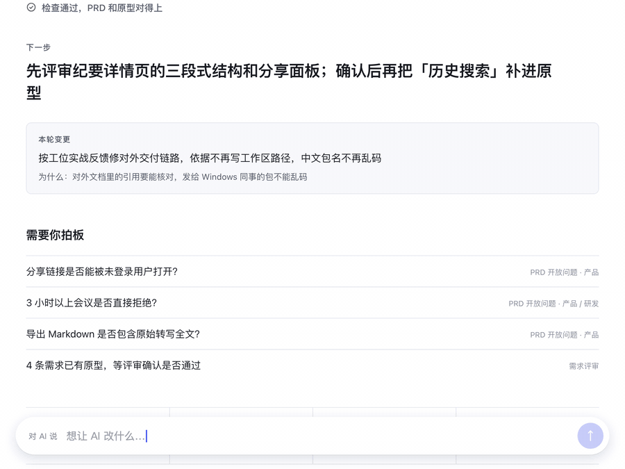
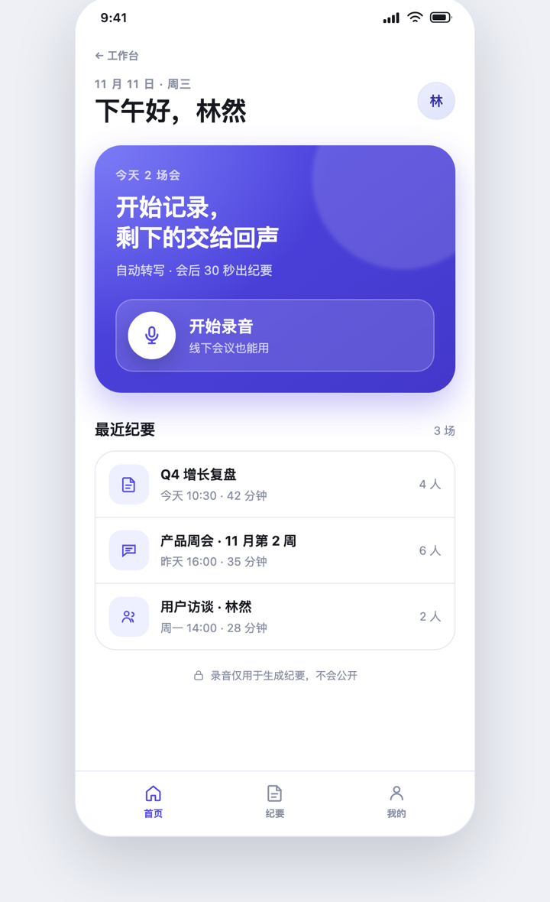

# 产品设计工位 · AI Product Studio

**我太太是产品经理。她不写代码、不用 git、也不碰终端，所以这个工位是照着她做的。**

她只对 AI 说话，PRD 和可点原型由 AI 保持同步，工作台负责把该她拍板的事摆到面前。

- 不用 git、不用命令行、不用记技能名，也不用知道文件放在哪。
- 每个工位只有一个入口 `工作台.html`：下一步、上一轮改了什么、需要你拍板什么、需求进度、原型，全在一页。
- 一致性不靠 AI「记得」，靠 `npm run check` 每次强制检查；没有运行时依赖，不需要 `npm install`。

**[▶ 在线演示](https://chee-0806.github.io/ai-product-studio/)**（示例产品「回声纪要」的只读工作台）· [一条命令开始](#开新项目)



## What is this (English)

A **workspace template for product managers who don't write code**. It was built for my wife — a PM who doesn't touch git or the terminal — because teaching her a toolchain was the wrong trade. You talk to an AI coding agent (Claude Code / Cursor / Codex) in plain language; the agent keeps a PRD and a clickable HTML prototype in sync, and regenerates one read-only dashboard you actually look at — next step, what changed last round, what needs your decision, requirement progress, prototype pages.

The PM never touches git, the terminal, or file paths. Three mechanical rules keep the documents honest:

1. every requirement has a stable ID (`REQ-001`), and prototype elements carry `data-req="REQ-001"`;
2. a requirement marked "prototyped" must have a page, one marked "dropped" must not;
3. the PRD version must equal the version in `STATE.md`.

`npm run check` enforces all three; `npm run sync` regenerates the dashboard. No runtime dependencies, no `npm install`.

```bash
bash <(curl -fsSL https://raw.githubusercontent.com/Chee-0806/ai-product-studio/main/install.sh) install ../my-product --name "My Product"
```

**[Live demo](https://chee-0806.github.io/ai-product-studio/)** · MIT.

## 为什么做这个

我太太是产品经理。她不写代码，不用 git，也不碰命令行。让她去学一套工具链，不如让工具假装不存在。

她说话的方式是「首页太满了，只留开始记录和最近三条」，不是「帮我改这个组件」。所以这个工位只承诺一件事：她用平时说话的方式提需求，剩下的 AI 做完——改 PRD、改原型、跑检查、刷新工作台，然后打开给她看。

代价是我这边得把机器做扎实。每个需求有固定 ID，原型里对应的元素得挂着它；标了「已完成原型」就必须真有页面，标了「已砍」就不能还有页面；PRD 版本和工作台版本必须对得上。这些只能机器查，不能指望 AI「记得」。



仓库：https://github.com/Chee-0806/ai-product-studio

## 先分清四个词

| 词 | 指什么 |
| --- | --- |
| **模板工程** | 这个仓库。只负责生成工位，不承载具体产品。 |
| **启动技能** | 装在用户级的 `product-studio`，负责从空文件夹建工位、升级工位、诊断环境。它自带模板，不依赖网络。 |
| **工位** | 每个产品一份的工作区，AI 在这里改 PRD 和原型。 |
| **工作台** | 工位根目录的 `工作台.html`，唯一给人看的只读首页，自动生成：下一步、上一轮改了什么、需要你拍板什么、需求进度、原型。 |
| **交付包** | 给研发的 zip，只含 PRD 和原型。 |

## 第一次用：对 AI 说一句话

不用装东西，不用打开文件夹，也不用输入命令。打开平时用的 AI 助手（Claude Code / Cursor / Codex），新建一个对话，把这段原样发过去：

> 从 https://github.com/Chee-0806/ai-product-studio 给我建一个产品工位，产品叫「宝宝喂养」。
> 需要装什么你自己装；装不了就停下来告诉我卡在哪，别让我运行命令。

它会自己装好需要的东西，把工位建起来，检查一遍，然后打开工作台给你看。

如果它说这台电脑缺运行环境、而且装不上，那是权限或网络的问题，不是你操作错了。把它的话转给帮你装电脑的人就行。

维护者想省掉每次下载，可以手动装一次启动技能（`npm run launcher:install`），之后建站不再联网。这一步产品经理不需要做。

工作台每次都由 AI 改完刷新并打开；你也可以自己双击工位文件夹里的 `工作台.html`。顶部会显示最近一次检查结果，变红说明内容可能不是最新的，让 AI 修好再刷新。

> 企业项目另有一套可选适配：手机/桌面/自适应三种原型形态、SPA 清单、外部资源白名单、需求「依据」字段。不是所有项目都要开，按需使用，详见 [`docs/enterprise.md`](docs/enterprise.md)。

## 她只需要做三件事

1. **看工作台**：AI 改完会打开给你。上面是当前阶段、下一步、上一轮改了什么、要你拍板什么。
2. **把想法直接说给 AI**：不用先写文档，它会先问关键问题，再改 PRD 和原型。
3. **点开原型看**：把不满意的地方告诉 AI，它改完会刷新工作台再打开。

不需要 git，不需要命令行，不需要知道文件放在哪。检查、版本记录、刷新和打开工作台都由 AI 完成。

## 常用工作流：说一句话，AI 自己按流程走

**你不需要记技能名。** 按场景说人话，AI 会根据 `AGENTS.md` 的路由自动选方法、按顺序做。

一条需求从有想法到能交付，一般是这样往前走：

1. **说出想法** —— 模糊的方向、访谈记录、客户反馈都行，不用先整理，AI 会追问关键问题。
2. **写成 PRD** —— 要做什么、怎样算做完；每条需求都有验收标准，你拿到一份能评审的需求文档。
3. **做成原型** —— 你拿到能点开的页面，主流程走得通，手机上也能看。
4. **一起评审** —— 检查 PRD 和原型对不对得上，告诉你必改什么、建议什么、还有什么等你拍板。
5. **导出交付** —— 你拿到给研发的交付包、评审用的 Word、向上汇报的 PPT。

已经有需求或页面要改，不用从头再来：直接说哪里不对，AI 会把 PRD 和原型一起改，再回到评审。

> 默认只装 4 个核心技能：做页面、评审、变更同步、交付产物。上面的第 1、2、5 步如果装了可选包 `pm-methods`，会走更完整的方法论（发散想法、按框架写 PRD、按受众写汇报）；没装也能做，AI 会用通用方法完成同样的事。

### 四个最常用的

**1. 从想法到可点原型**

> 我有个想法：给宝妈做一个宝宝喂养记录工具。先别写方案，先问我几个关键问题。

装了 `pm-methods` 时，AI 会先陪你发散想法，再写成 PRD、做原型、评审；没装则由核心流程直接完成。

你拿到：PRD 里的需求、可点原型、刷新后的工作台。

**2. 改已有功能**

> 首页太满了，只保留开始记录和最近三条。

装了 `pm-methods` 时，AI 会先找出哪些需求受影响、必要时把 PRD 写规范、再改原型和评审；没装时直接把需求与原型一起改。

你拿到：PRD 与原型同步更新，版本 +1，工作台刷新。

**3. 评审 / 收尾**

> 帮我评审，看看 PRD 和原型哪里不一致，还有什么没定。

AI 会走：`review`，先跑机器检查，再给你「必改 / 建议 / 无法验证」。

**4. 交付产物**

> 导出评审版 Word / 给甲方做一份评审材料 / 做个汇报 PPT / 发给研发。

AI 会走：`deliver`。研发包可以机械打包；Word、PPT、封面、审批栏、修订记录由 agent 按受众生成，不写死脚本。

### 其他场景怎么说

| 你说（示例） | AI 会走 | 你会拿到 |
| --- | --- | --- |
| 我有个想法 / 帮我发散 / 这个方向靠谱吗 | `product-brainstorming` | 方向、假设、风险 |
| 这是我访谈/问卷/客服记录，帮我归纳 | `synthesize-research` | 主题、证据、机会 |
| 把需求写成 PRD / 加一条需求 / 补验收 | `write-spec` | REQ 块与验收 |
| 一期做什么 / 砍哪些 / 排优先级 | `roadmap-update` | 必须/应该/可以/不做 |
| 做个新页面 / 补空状态 | `prototype` | 可点页面 |
| 帮我评审 / 检查一致性 | `review` | 必改 / 建议 / 未验证 |
| 改现有页面 / 改文案 / 改需求 | `change` | 两边同步 + 版本 |
| 导出交付包 / 评审 Word / 汇报 PPT | `deliver` | 按受众组织的产物与自检结果 |
| 写周报 / 向上汇报 / 发布公告 | `stakeholder-update` | 按受众定制的稿子 |
| 看竞品 / 做个竞品对比 | `competitive-brief` | 竞品简报 |
| 看指标 / 复盘这周数据 | `metrics-review` | 指标复盘与行动 |
| 排下个迭代 | `sprint-planning` | 迭代计划（可选） |

不用背这张表；只要说清「现在是什么场景、你想得到什么」，AI 会选。选错了直接说「这不是我要的，换一个」。

带 Anthropic 方法名的几行需要先安装 `pm-methods`；没装时 AI 会用核心流程和通用方法完成，只是输出没那么套框架。

## 给 AI 的第一句话

把文件夹用 **Claude Code / Cursor / Codex** 等能读写本地文件的 AI 打开，然后粘贴：

```text
你是我的产品搭档。先读 AGENTS.md、STATE.md 和 product/PRD.md，用一句话告诉我现在做到哪、下一步做什么。
然后按我说的改。改完自己运行 npm run sync 和 npm run check，刷新工作台，再告诉我：改了哪些需求、哪些页面、还有什么没定。
不要要求我运行命令，也不要让我碰 git。
```

之后正常说需求即可，例如：

- 「我想做一个给宝妈记录宝宝喂养的工具，先别写方案，先问我 10 个关键问题。」
- 「首页太满了，只保留开始记录和最近三条。」
- 「这个流程还缺一个空状态，帮我补上。」
- 「检查一下 PRD 和原型是不是一致，刷新工作台。」

## 工作台长什么样

`工作台.html` 是唯一入口，由脚本生成，包含七块：

- **下一步**：当前阶段和下一件具体要做的事（来自 `STATE.md`）。
- **本轮变更**：上一轮改了什么、为什么改、影响哪几条需求（来自 `STATE.md` 的上一轮摘要）。
- **需要你拍板**：把待定问题集中摆出来——PRD 的开放问题、交接板上的阻塞、以及等你评审通过的需求，不用自己翻文档。
- **怎么用**：三步说明、常用说法和给 AI 的开场白。
- **要发给研发**：怎么生成只含 PRD 与原型的交付包；评审 Word / 汇报材料走 `deliver` 技能。
- **需求进度**：每条需求的状态，以及它在哪个原型页面；开启 `basis_required` 时还会显示依据。
- **原型页面**：每个页面的缩略图，按手机/桌面/自适应比例展示；点开是可交互原型。

缩略图是把页面样式内联后渲染的，所以**双击 HTML 就能看**，不需要启动本地服务。含外部资源、超大 SPA 或地图页会自动降级为占位卡；这时让 AI 跑一次 `npm run previews`，它会用本机浏览器把每个界面截成预览图，工作台就不再是占位卡。

## 怎么发给研发

平时整个文件夹是**工作区**，不要直接打包发——里面还有 `STATE.md`、脚本、内部工作台和调研记录。

对 AI 说一句：**「导出交付包」**。它会走 `deliver` 技能，先检查一致性，再直接组装（没有 `npm run export` 这个脚本）：

```text
dist/
  回声纪要-v0.2.0/
    index.html              交付首页（先打开这个）
    PRD.html                可直接阅读的 PRD
    PRD.md                  原始 Markdown
    README.md               交付说明
    prototype/
      index.html            原型目录
      screens/*.html        可点页面（多页）
      assets/*.css          共享样式
  回声纪要-v0.2.0.zip       发给研发的就是这个
```

如果是 SPA，`prototype/` 里是入口文件与它依赖的脚本/数据，`prototype/index.html` 仍作为界面目录；`screens.json`、`external.json`、`previews/` 不进入交付包。

如果要给评审/甲方一份 Word，不要用交付包里的 HTML 凑；对 AI 说「导出评审版 Word」，它会走 `deliver` 技能，生成封面、修订记录、审批栏、需求依据与未决问题，再用可用工具输出真正的 `.docx`。产物生成不写成脚本。

**只发 zip。** 包内只有 PRD 和原型，不包含内部工作台、`STATE.md`、脚本、调研原始材料和决策记录。PRD 里引用的内部资料在渲染时会变成普通文字；研发需要时再单独提供。

zip 由 Python 打（文件名带 UTF-8 标志，Windows 解压不乱码），导出后工位根目录还会留一份同名副本——`dist/` 是生成物，在文件应用里常常看不到，AI 会把绝对路径告诉你。如果电脑没有 Python，直接把 `dist/回声纪要-v0.2.0/` 文件夹发过去也可以。

PRD 改版后，之前导出的 HTML、Word、汇报材料都算过期快照：让 AI 重新生成，不要在一堆旧文件里手工改。

## 目录

```text
工作台.html               唯一入口，自动生成，禁止手改
index.html                在线演示的跳转页（GitHub Pages 根）
media/                    README 用的动图与截图，不进入工位
BOOTSTRAP.md              从零建站说明，给 AI 看
install.sh               远程安装入口
AGENTS.md                 AI 的工作契约
CLAUDE.md                 Claude Code 入口，指向 AGENTS.md
STATE.md                  当前阶段、版本、下一步
README.md                 本文件

product/
  PRD.md                  需求与验收的唯一事实源
  discovery/              问题定义与证据
  decisions/              ADR：一次决策一个文件，只增不改

prototype/
  screens/                多页正式原型，进入工作台
  screens.json            SPA 清单：入口、路由、界面与需求（可选）
  external.json           外部资源白名单（可选）
  previews/               工作台静态预览图（可选，不进入交付包）
  spikes/                 探索稿，不进入工作台
  assets/                 共享视觉样式与本地 vendor

launcher/                 用户级启动技能的源文件（建站、升级、诊断）
  product-studio/         装到 ~/.claude/skills 后从空文件夹建工位

skills/                   默认安装的核心技能
  prototype/              做页面（本工位）
  review/                 评审一致性（本工位）
  change/                 变更同步（本工位）

packs/                    可选内容包，默认不安装
  pm-methods/             8 个 Anthropic 官方 PM 方法技能

LICENSE                   自有代码与文档的 MIT 许可证
THIRD_PARTY_NOTICES.md    外部技能来源与修改说明
LICENSES/                 第三方许可证原文

scripts/
  sync.mjs                一致性检查 + 生成工作台
  check-skills.mjs        技能格式检查
  new.mjs                 从模板创建新项目
  upgrade.mjs             把工位的规则、脚本、技能升级到当前版本（自动备份，可 --rollback）
  previews.mjs            批量生成工作台预览图
  launcher.mjs            打包/安装用户级启动技能
  pack.mjs                安装/移除可选内容包
  serve.mjs               可选的本地预览服务
  lib/screens.mjs         多页/SPA 页面读取与外部资源匹配

docs/                     工作流、一致性模型、原型规范、评审清单、企业适配
dist/                     交付包与启动技能（生成物，不提交）
```

## 内置技能

> 这一节给 AI 和维护者看，你不需要记。日常只看上面的「常用工作流」。

技能分两层，默认只装核心的 4 个：

- **核心技能（默认安装）**：`prototype`（做页面）、`review`（评审一致性）、`change`（改需求时两边同步）、`deliver`（交付包/评审 Word/PPT）。前三个负责 PRD ↔ 原型闭环，`deliver` 负责把闭环结果变成受众能读的产物。
- **可选内容包 `pm-methods`（默认不安装）**：`write-spec`、`roadmap-update`、`synthesize-research`、`stakeholder-update`、`product-brainstorming`、`metrics-review`、`competitive-brief`、`sprint-planning`。需要时：

  ```bash
  npm run pack:add -- pm-methods
  npm run pack:remove -- pm-methods
  ```

  源文件在 `packs/pm-methods/skills/`，不安装时不参与路由，也不会被 Claude Code 发现。不需要可以整个删除 `packs/`。

来自 Anthropic 的 8 个技能采用 Apache-2.0，做了中文触发与文件落点适配；来源、固定 commit、修改点写在 `THIRD_PARTY_NOTICES.md`，许可证在 `LICENSES/Apache-2.0.txt`。技能说明见 `skills/README.md`。

产品经理不需要记这些名字；她只要说「帮我评审」「先问我几个问题」「把首页改简单点」，AI 会选技能。技能格式由 `npm run check:skills` 校验，也包含在 `npm run check` 里。

## 一致性是怎么保证的

不是靠 AI「记得」同步，而是靠三个约束：

1. **需求有固定 ID**：`REQ-001`，永不复用；原型里实现某条需求的元素带 `data-req="REQ-001"`。
2. **状态和页面必须对得上**：标了「已完成原型」就必须有页面；标了「已砍」就不能还有页面。
3. **版本只有一个来源**：PRD 的版本必须等于 `STATE.md` 的版本；工作台必须是最新生成物。

`npm run check` 会检查这些规则。AI 每次改完都会自己跑；失败就自己修，不会让用户处理。

**它不检查语义**：文案是否真的符合验收、边界态是否合理，仍然需要人看一眼。评审清单在 `docs/review-checklist.md`。

## 维护者：第一次设置

1. **生成一个工位**：运行 `npm run new -- ../她的项目 --name "产品名"`，或从 GitHub 用 `install.sh`。想先看示例，就直接打开本仓库。
2. 确保电脑上有 **Node.js ≥ 18**（只用于 AI 运行检查；单纯看工作台不需要）。没有的话让 AI 帮你装，或从 [nodejs.org](https://nodejs.org) 安装 LTS。
3. 用能读写本地文件的 AI 打开文件夹，粘贴上面的开场白。
4. 让她先双击 `工作台.html` 熟悉一下；如果是新工位，直接从第一条需求开始。
5. **git 是可选的**：如果文件夹里有 `.git`，AI 可以在检查通过后自动提交留底，不需要她操作；没有 `.git` 也完全不影响使用。不要教她 git。

常用命令（只给维护者/AI）：

| 命令 | 作用 |
| --- | --- |
| `npm run sync` | 检查并重建 `工作台.html` |
| `npm run previews` | 用本机浏览器给大页面/SPA 批量生成工作台预览图 |
| `npm run check` | 严格检查，失败即退出（含技能格式） |
| `npm run check:skills` | 检查已安装技能与可选包源的格式 |
| `npm run pack:list` | 查看可选内容包与安装状态 |
| `npm run pack:add -- pm-methods` | 安装 8 个官方 PM 方法技能 |
| `npm run pack:remove -- pm-methods` | 移除该内容包（核心技能不动） |
| `npm run new` | 从模板创建一个新项目 |
| `npm run dev` | 可选：本地预览，默认 http://localhost:4173 |

不需要 `npm install`，没有运行时依赖。交付包、评审 Word、PPT 没有单独命令，统一走 `deliver` 技能。

## 开新项目

### 从 GitHub 一条命令

```bash
bash <(curl -fsSL https://raw.githubusercontent.com/Chee-0806/ai-product-studio/main/install.sh) install ../宝宝喂养 --name "宝宝喂养"
```

也可以走管道：

```bash
curl -fsSL https://raw.githubusercontent.com/Chee-0806/ai-product-studio/main/install.sh | bash -s -- install ../宝宝喂养 --name "宝宝喂养"
```

`install` 后面是目标目录；脚本会下载模板、生成干净工位、自动检查，并打印入口。要求 **Node.js ≥ 18**。

可选参数：

- `--name "产品名"`：PRD 和工作台显示的名字；默认用目录名；
- `--git`：新目录初始化 git（不自动提交）；
- `--with-pack pm-methods`：同时安装 8 个官方 PM 方法技能（默认不装）；
- `--ref v0.2.0`：固定使用某个分支、标签或 commit。

介意 `curl | bash` 的话，可以先下载 `install.sh` 看一遍再执行。

> GitHub 仓库已开启 Template；「Use this template」复制的是整份模板（含示例 PRD/原型）。要直接得到干净工位，用上面的 `install.sh`。

### 在本地模板目录

模板目录保留不动；每个产品单独生成一个工位：

```bash
npm run new -- ../宝宝喂养 --name "宝宝喂养"
```

这类做法参考了 [Vite 的 `npm create`](https://vite.dev/guide/#scaffolding-your-first-vite-project)、[Spec Kit 的 `specify init`](https://github.github.com/spec-kit/installation.html) 和 [Spring CLI 的 `boot new`](https://docs.spring.io/spring-cli/reference/ref/project/comments-on-the-approach.html)：**从一份可运行的骨架复制**，而不是让用户从空目录拼模板。区别是这里不发布 npm 包，只保留本地脚本；远程分发用 `install.sh`。

不带参数会进入交互模式：

```bash
npm run new
```

新工位会得到一套干净的骨架：

- 新的 `product/PRD.md`（`0.1.0`、空需求、待补充的摘要与指标）；
- 新的 `STATE.md`（`discovery` 阶段 + 下一步）；
- 空的 `prototype/screens/`，没有示例页面；
- 复制 `AGENTS.md`、核心 `skills/`、可选 `packs/`、`docs/`、脚本、样式和许可证说明；
- 自动生成 `工作台.html`，并通过一致性检查；
- 不复制示例 PRD、示例原型、`.git` 历史和 `dist/`。

可选参数：

- `--name "产品名"`：PRD 和工作台显示的名字；默认用目录名；
- `--git`：新目录初始化 git（不自动提交）；
- `--with-pack pm-methods`：同时安装 8 个官方 PM 方法技能（默认不装）。

**不要在模板目录里面创建项目**，目标目录必须在模板之外（例如 `../项目名`）。生成后，用 AI 打开新目录，粘贴新 `README.md` 里的开场白即可。

### 不想用命令

也可以手动复制整个文件夹，然后删除示例内容：清空 `product/PRD.md` 的需求、重置 `STATE.md`、删除 `prototype/screens/*.html` 和 `.git`，最后运行 `npm run sync`。不推荐——容易漏掉示例文件，也容易把模板的 git 历史带过去。

## 设计取舍

- **工作台是唯一入口**：产品经理不需要记目录、命令或文件格式。
- **PRD 与原型各管一种真相**：PRD 管要做什么和验收，原型管界面与交互；覆盖关系自动推导。
- **核心与内容包分离**：默认只装 4 个核心技能；8 个 PM 方法技能按需安装，避免每个工位都背一整套方法论。
- **产物生成走技能，不走脚本**：检查、工作台和机械打包是确定性脚本；评审 Word、PPT、甲方材料需要判断和排版，交给 `deliver` 技能，不写 `review.mjs` 这类硬编码生成器。
- **构建状态可见**：工作台顶部显示检查结果；检查失败时明确标红，不静默保留旧页面。
- **原型用静态 HTML**：双击可开、可 diff、AI 能直接改；代价是复杂交互验证不了。
- **一致性模型稳定，形态做适配器**：PRD ↔ 原型的追溯模型不变；多页/SPA、手机/桌面、研发包/评审包是外层适配，不重写核心。
- **外部资源不无条件放开**：必须显式白名单，优先 vendor；离线可用性由部署方确认，模板工程不假装能保证。
- **不做第二份进度表**：进度只写在需求状态里，工作台由脚本生成。
- **不要求 git**：git 只作为 AI 的隐形留底，不作为使用门槛。

## 许可证

- 本仓库自有代码、脚本、文档与原型样式：**MIT**，见 [`LICENSE`](LICENSE)。
- `packs/pm-methods/skills/` 中来自 Anthropic 的 8 个技能：**Apache-2.0**，许可证原文在 [`LICENSES/Apache-2.0.txt`](LICENSES/Apache-2.0.txt)，来源与修改说明见 [`THIRD_PARTY_NOTICES.md`](THIRD_PARTY_NOTICES.md)。

## 社区参考

- [cursor-pm-template](https://github.com/olehmell/cursor-pm-template)：按文件夹拆分 `AGENTS.md`，共享产品上下文与产物目录。
- [ai-prototyping-workflow](https://github.com/jitu5/ai-prototyping-workflow)：阶段化规格 + `PROGRESS.md` 活状态 + spec-drift 检查。
- [github/spec-kit](https://github.com/github/spec-kit)：spec → plan → tasks → implement 的规格驱动流程。
- [pm-ai-toolkit](https://github.com/xuqiang97/pm-ai-toolkit)：面向中文产品经理的 AI 工作流与 HTML 高保真原型。
- [Prodstack: single source of truth](https://www.prod-stack.ai/blog/single-source-of-truth-ai-product-teams) 与 [agentappbuilder: prototype/code sync](https://agentappbuilder.com/blog/keep-prototype-and-code-in-sync)：每种真相一个权威源、双向追溯、变更找下游而不是靠记忆。

这个工位的差异：把「一致性」从口头约定做成 AI 每次必须执行的检查，并给非技术用户一个双击即用的入口。

## 已知限制

- 语义一致性（文案、边界、交互是否符合验收）无法全自动判断，需人工评审。
- 工作台显示的是最近一次生成时的检查结果；AI 没运行刷新时，它不会自己更新。
- 工作台缩略图只内联 `assets/app.css` 与页面自身；外部资源页面会降级为占位卡，有 `previews/` 时显示预览图。
- SPA 的追溯粒度是路由，不是页面里的每个元素；需要更细的追溯时，在入口 HTML 里补 `data-req`。
- 外部资源白名单只校验声明，不校验资源是否可访问；内网/离线交付仍需提前 vendor。
- 需要 AI 能读写本地文件夹；纯网页版聊天工具改不了文件。
