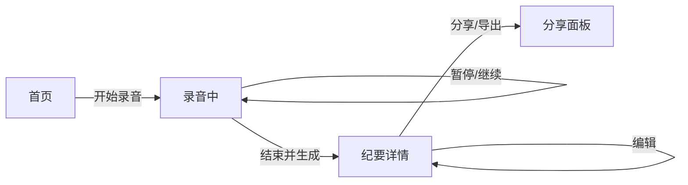

# 回声纪要 · PRD

> 把一场会，变成一份能直接执行的纪要。
> 本文是**需求与验收的唯一事实源**。界面长什么样以 `prototype/screens/` 为准；为什么这样取舍以 `product/decisions/` 为准。

## 0. 一页摘要

| 项目 | 内容 |
| --- | --- |
| 问题 | 会后整理纪要平均耗时 25 分钟，且待办经常丢失负责人和截止时间 |
| 目标用户 | 每天 2 场以上会议、需要向团队同步结论的产品/项目负责人 |
| 方案 | 一键录音 → 实时转写 → 自动生成「摘要 / 决议 / 待办」三段式纪要 → 编辑并分享 |
| 本期目标 | 把「会后 25 分钟整理」压缩到 3 分钟以内 |
| 北极星指标 | 生成后 24 小时内被分享或导出的纪要占比 |
| 不做什么 | 不做会议排期、不做视频会议、不做多人实时协同编辑 |

## 1. 背景与证据

详见 [`discovery/001-problem-brief.md`](discovery/001-problem-brief.md)。

- 5 位目标用户访谈中，5 位都表示「会后凭记忆补纪要」，其中 3 位承认漏过待办。
- 现有工具要么只做转写（仍需人工整理），要么绑定在特定会议软件里（线下会无法使用）。
- 用户对 AI 摘要的容忍阈值是：**结构必须稳定**。宁可少写，也不要每次结构不同。

## 2. 用户与场景

| 角色 | 场景 | 关键诉求 |
| --- | --- | --- |
| 会议发起人 | 线下/线上会议开始前 | 一步开始录音，不打断会议 |
| 会议发起人 | 会后 5 分钟内 | 快速拿到结论与待办，改两处就能发 |
| 参会人 | 收到纪要后 | 30 秒内看懂结论，知道自己的待办 |

核心 Job：

> 当我刚开完一场会，我想在 3 分钟内发出一份结构稳定的纪要，这样团队不用等我回忆，也不会漏掉待办。

核心流程：

## 3. 范围

### 3.1 本期做

- 一键开始录音，录音中实时转写、暂停与继续。
- 会后自动生成三段式结构化纪要：摘要、关键决议、待办。
- 纪要编辑、复制分享链接、导出 Markdown。
- 历史纪要列表（只读，不含搜索）。

### 3.2 明确不做

- 会议排期、日历同步、视频会议能力。
- 多人实时协同编辑。
- 说话人自动分离（见 REQ-006，已移出本期）。
- 历史全文搜索（见 REQ-005，本期只有列表，搜索下期做）。

### 3.3 依赖与假设

- 依赖 ASR 服务在中文会议场景的实时准确率 ≥ 90%。
- 假设用户允许麦克风权限；拒绝权限时必须有可理解的兜底提示。
- 假设单场会议时长 ≤ 3 小时；超长会议不在本期验证范围。

## 4. 信息架构

| 层级 | 内容 |
| --- | --- |
| 一级 | 首页（开始录音 + 最近纪要）、纪要库、我的 |
| 二级 | 录音中、纪要详情、分享面板 |
| 常驻 | 底部导航：首页 / 纪要 / 我的 |

界面文件、页面数量与覆盖关系不在这里维护，由原型页面的 `data-req` 自动汇总到 `工作台.html`。

## 5. 需求

### REQ-001 一键开始录音

- **状态**: prototyped
- **优先级**: P0
- **用户故事**: 作为会议发起人，我希望在会议开始时一步进入录音，不打断会议节奏。
- **行为**:
  1. 首页主操作区展示「开始录音」按钮，并说明会后自动生成纪要。
  2. 点击后进入录音页并立即请求麦克风权限。
  3. 权限被拒绝时，停留在首页并提示开启麦克风的路径。
- **验收**:
  - [ ] 首页主按钮文案为「开始录音」，点击进入录音页。
  - [ ] 首次使用展示麦克风权限说明；拒绝后给出开启路径，不进入空白页。
- **边界**: 录音中退出应用需二次确认；本期原型不模拟系统级权限弹窗。

### REQ-002 录音中实时转写

- **状态**: prototyped
- **优先级**: P0
- **用户故事**: 作为会议发起人，我希望看到实时转写，确认录音真的在工作。
- **行为**:
  1. 录音页展示计时、波形和按说话人分段的实时文本。
  2. 提供「暂停」与「结束并生成」两个操作。
  3. 暂停后计时与转写同时停止；继续后从原位置恢复。
- **验收**:
  - [ ] 录音页每秒更新计时，波形随音量变化。
  - [ ] 暂停后计时与转写停止，继续后恢复，且不丢失已转写内容。
  - [ ] 点击「结束并生成」进入纪要详情页。
- **边界**: 网络中断时保留本地录音，恢复后继续转写；错误态见第 6 节。

### REQ-003 自动生成三段式纪要

- **状态**: prototyped
- **优先级**: P0
- **用户故事**: 作为会议发起人，我希望会后就拿到结构固定的纪要，改两处就能发。
- **行为**:
  1. 生成结果固定包含三部分：摘要、关键决议、待办。
  2. 「摘要」不超过 3 条；「关键决议」每条包含结论与背景；「待办」包含事项、负责人、截止时间。
  3. 负责人或截止时间缺失时，显示「待确认」，不编造。
- **验收**:
  - [ ] 生成结果固定包含摘要、关键决议、待办三部分，顺序不变。
  - [ ] 待办项包含负责人与截止时间；缺失时显示「待确认」。
  - [ ] 摘要不超过 3 条，每条不超过 60 字。
- **边界**: 会议时长 < 3 分钟时，不生成「关键决议」，仅保留摘要与待办。

### REQ-004 纪要编辑与分享

- **状态**: prototyped
- **优先级**: P0
- **用户故事**: 作为会议发起人，我希望快速修正纪要并分享给参会人。
- **行为**:
  1. 标题栏提供「编辑」与「分享」入口。
  2. 编辑态下正文可直接修改，退出编辑后保留本次修改。
  3. 分享面板提供「复制链接」与「导出 Markdown」。
- **验收**:
  - [ ] 标题栏提供「编辑」「分享」入口。
  - [ ] 分享面板提供复制链接与导出 Markdown 两个操作。
  - [ ] 编辑态下正文可修改，点击「完成」后保留修改。
- **边界**: 分享链接默认 7 天有效；本期原型不实现真实鉴权。

### REQ-005 历史纪要搜索

- **状态**: draft
- **优先级**: P1
- **用户故事**: 作为会议发起人，我希望按关键词找回几个月前的结论。
- **行为**:
  1. 支持按标题、参会人、纪要正文关键词搜索。
  2. 结果按时间倒序，展示标题、日期与命中片段。
  3. 无结果时展示空状态与「开始新录音」入口。
- **验收**:
  - [ ] 搜索覆盖标题、参会人与正文，命中关键词高亮。
  - [ ] 无结果时展示空状态，并可一键开始新录音。
- **边界**: 本期只做列表，不建搜索索引；原型待补。

### REQ-006 说话人自动分离

- **状态**: dropped
- **优先级**: P2
- **放弃原因**: 目标用户中 4/5 表示「能看懂谁说了什么」即可，自动分离带来的等待时间不可接受；本期移出范围，等 ASR 支持流式说话人分离后重评。
- **原计划**: 录音中自动标注 A/B/C 说话人，并允许重命名。

## 6. 全局状态与边界

| 场景 | 期望表现 |
| --- | --- |
| 首次进入 | 首页展示示例纪要，说明数据仅存本地 |
| 麦克风权限拒绝 | 首页提示开启路径，保留「开始录音」按钮 |
| 录音中网络中断 | 顶部显示「转写暂停，录音继续」，恢复后自动续传 |
| 生成失败 | 纪要页展示失败原因与「重新生成」，原始转写不丢 |
| 纪要为空 | 空状态文案「这场会没有产生可执行结论」，提供手动补充入口 |
| 分享链接过期 | 打开后提示联系发起人重新分享 |

## 7. 指标

| 指标 | 定义 | 目标 |
| --- | --- | --- |
| 录音启动率 | 进入首页后点击「开始录音」的占比 | ≥ 35% |
| 生成成功率 | 结束录音后 60 秒内成功出纪要的占比 | ≥ 98% |
| 24h 分享/导出率 | 生成后 24 小时内被分享或导出的纪要占比 | ≥ 40% |
| 编辑率 | 生成后被人工编辑过的纪要占比 | ≤ 60%（过高说明生成质量不足） |

## 8. 风险与依赖

- ASR 准确率不达标会直接拉低分享率；需要在上线前用 20 场真实会议做回归。
- 「待确认」过多会让纪要显得不可用；生成侧需要给出缺失原因。
- 本地录音涉及隐私，必须在首页明确「录音仅用于生成纪要」。

## 9. 开放问题

| 问题 | 负责人 | 提出于 | 状态 |
| --- | --- | --- | --- |
| 分享链接是否能被未登录用户打开？ | 产品 | v0.2.0 | 待定 |
| 3 小时以上会议是否直接拒绝？ | 产品 / 研发 | v0.2.0 | 待定 |
| 导出 Markdown 是否包含原始转写全文？ | 产品 | v0.2.0 | 待定 |

## 10. 参考资料

- 用户访谈 2026-11（5 位会议发起人，纪要由产品经理保管）
- 会议纪要工具竞品观察 2026-11（3 款在线工具的功能与结构对比）
- 产品方向决策：纪要结构必须稳定、说话人分离移出本期

原件不随交付包外发，需要核对时向产品经理索取。

## 11. 变更记录

| 版本 | 日期 | 变更 | 影响需求 |
| --- | --- | --- | --- |
| 0.2.2 | 2026-11-12 | 开放问题加「提出于」列，机器才能算出一条问题挂了几轮 | 无 |
| 0.2.1 | 2026-11-12 | 新增「参考资料」一节，集中登记来源；依据不再写工作区路径 | 无 |
| 0.2.0 | 2026-11-11 | 补齐验收标准；落地三页可交互原型；搜索降为下期、说话人分离移出范围 | REQ-001 ~ REQ-006 |
| 0.1.0 | 2026-11-05 | 首版范围、用户故事与需求拆分 | REQ-001 ~ REQ-006 |
